<div align="center">


# Heros Todo — Markdown · PDF · LaTeX Panel Studio

### The fastest, most private, most powerful notes panel for your browser.
### Read - Task - Study - Search - 100% Local - Free - Unlimited

<br/>

[](./todo-panel-extension/manifest.json)
[](https://developer.chrome.com/docs/extensions/reference/sidePanel/)
[](#privacy-and-security)
[](#why-heros-todo)
[](./FEATURES.md)
[](#themes-and-eye-comfort)

<br/>

[](./FEATURES.md)
[](./FEATURES.md)
[](./FEATURES.md)
[](./FEATURES.md)
[](#installation--30-seconds)
[](#installation--30-seconds)
[](#installation--30-seconds)
[](./LICENSE)

**Website:** `https://ahmedbakr78.github.io/Heros_Todo/`  |  **Extension folder:** [`todo-panel-extension/`](./todo-panel-extension/)  |  **All features:** [`FEATURES.md`](./FEATURES.md)  |  **Issues:** [Report a bug](https://github.com/Ahmedbakr78/Heros_Todo/issues/new/choose)  |  **Ideas:** [Request it](https://github.com/Ahmedbakr78/Heros_Todo/issues/new/choose)

> **One-line description for the GitHub About box (copy-paste, no emojis):**
> `Heros Todo — fast, private, unlimited Markdown + PDF + LaTeX panel studio. Multi-workspaces, tasks, diagrams, study tools. Dark + Light, 100% local, free forever.`

</div>

---

## Table of Contents

- [Description (short, medium, long)](#description-short-medium-long)
- [Why Heros Todo?](#why-heros-todo)
- [Demo / How it looks](#demo--how-it-looks)
- [Feature Universe — The Complete List](#feature-universe--the-complete-list)
- [Heros Todo vs Everyone Else](#heros-todo-vs-everyone-else)
- [Architecture and Diagrams](#architecture-and-diagrams)
- [Data Flow and Rendering Pipeline](#data-flow-and-rendering-pipeline)
- [Markdown Engine](#markdown-engine)
- [LaTeX Engine](#latex-engine)
- [PDF Engine in the Panel](#pdf-engine-in-the-panel)
- [Workspaces and Files](#workspaces-and-files)
- [Task Engine](#task-engine)
- [Study System](#study-system)
- [Privacy and Security](#privacy-and-security)
- [Sequence Flows — End-to-End Journeys](#sequence-flows--end-to-end-journeys)
- [Error Handling and Resilience](#error-handling-and-resilience)
- [Accessibility](#accessibility)
- [Installation — 30 Seconds](#installation--30-seconds)
- [Usage Guide](#usage-guide)
- [Keyboard Shortcuts](#keyboard-shortcuts)
- [Todo Handbook](#todo-handbook)
- [Search Handbook](#search-handbook)
- [Builder Lab Handbook](#builder-lab-handbook)
- [Export Handbook](#export-handbook)
- [Themes and Eye Comfort](#themes-and-eye-comfort)
- [Responsive and Panel-First](#responsive-and-panel-first)
- [Performance Engineering](#performance-engineering)
- [Design System and Visual Language](#design-system-and-visual-language)
- [Internals — Inside app.js](#internals--inside-appjs)
- [Release and Publishing Pipeline](#release-and-publishing-pipeline)
- [Contribution Workflow](#contribution-workflow)
- [Compatibility Matrix](#compatibility-matrix)
- [Project Stats](#project-stats)
- [Glossary](#glossary)
- [Repository Structure](#repository-structure)
- [Tech Stack](#tech-stack)
- [Roadmap](#roadmap)
- [FAQ — 20 Questions](#faq--20-questions)
- [Changelog and Releases](#changelog-and-releases)
- [GitHub Topics, About and Website Setup](#github-topics-about-and-website-setup)
- [License and Credits](#license-and-credits)
- [Author](#author)

---

## Description (short, medium, long)

Pick the length you need. All three are emoji-free and ready for GitHub About, the website meta tags, or a store listing.

**Short (1 line, About box):**

```text
Heros Todo — fast, private, unlimited Markdown + PDF + LaTeX panel studio. Multi-workspaces, tasks, diagrams, study tools. Dark + Light, 100% local, free forever.
```

**Medium (1 paragraph, social shares):**

```text
Heros Todo is a fast, private, unlimited panel studio for your browser sidebar.
Pick any folder and every .md, .pdf, .tex and .txt appears instantly — across
unlimited workspaces with pins, colors and filters. Read perfect Markdown with
offline LaTeX math and lazy Mermaid diagrams, view PDFs without uploading,
click - [ ] tasks to change the real file, and study with flashcards, quizzes,
Anki export, pomodoro, habits and goals. Dark + Light + System, silent instant
boot, 100% local. No account, no tracking, no limits. Free forever (MIT).
```

**Long (full product description, website hero + store listing):**

```text
Heros Todo turns the browser side panel into a complete notes studio.
FILES: pick any folder — recursive scan (2000 cap, chunked, progress) lists
every .md .markdown .txt .tex .latex .bib .pdf with type badges, folder-tree
groups, 6 sort orders, filter chips, starred, recents, reading bookmarks.
WORKSPACES: unlimited, instant switching, each remembers its last note, pins,
colors, filter, rename/remove, stale-handle re-pick recovery.
READ: GFM tables with tap-to-sort, interactive - [ ] / - [x] that write back
to the real file, footnotes, frontmatter chips, callouts, details, [[toc]],
==mark==, [[wikilinks]], #tags + backlinks, outline with scroll spy, section
time badges, RTL, CJK counting, code copy bars, in-file find, regex search,
read-aloud TTS, progress bar. MATH: offline KaTeX ($, $$, \( \), \[ \],
currency-safe) + TEX section outline + math preview + BIB browser.
DIAGRAMS: Mermaid 9 types, lazy idle-time, themed, SVG export, perf-mode skip.
PDF: lazy DPR-capped pages, jump, zoom, outline, text search, thumbnails,
password unlock, page PNG, pdf-lib merge, print. STUDY: markers (7 colors,
H/U/S/C mini-bar), flashcards (headings/Q:A/bold/cloze), quiz + score, Anki
TSV round-trip, study packs, notes, stopwatch + laps, pomodoro + chime,
counters, 14-day habits + streaks, writing goals, reading tracker. BUILD:
live builder, auto-save drafts, wrap, counts, table/TOC generators,
Ctrl+Enter task toggle, templates, URL load, lint, summary, keywords,
readability, diff + patch, link check, spell scan, custom CSS. TASKS:
!!! priorities, @YYYY-MM-DD dues, overdue red, 4-way due filters, Today
modal, daily + random notes, checklist import, TXT export. COMFORT: dark /
light / system, 6 accents, night / sepia / dim, 4 widths, 3 fonts, justify,
sentence focus, focus mode, fullscreen + present. COMMANDS: Ctrl+K palette
(40+). PRIVACY: sidePanel + storage
permissions only, no tabs, no servers, no analytics. PRICE: free forever,
unlimited files, tasks, merges and diagrams, MIT open source. Browsers:
Chrome, Edge, Brave, Opera, Arc and any Chromium browser.
```

---

## Why Heros Todo?

Most notes extensions are either a single text box, a paid cloud app, or upload your files to a server.

Heros Todo is the opposite:

| Principle | What it means in practice |
|---|---|
| Fastest ever | Vendored engines, debounced rendering, idle-time diagrams, DPR-capped PDF, chunked scans, capped search, silent instant boot |
| Careful design | Ultra-rounded floating cards, pill tab bars, floating sidebar, dark + light + system + night + sepia, icon-everywhere UI |
| 100 percent private | Files never leave your device. No account, no tracking, no analytics, no server. IndexedDB + storage.local only |
| Free and unlimited | No note limits, no paywalled export, no "3 free diagrams per day". Merge, quiz, track, back up — forever |
| Panel-first | Lives in the side panel next to your work. No tab juggling, no window management |
| Power-user | Regex search, wikilinks, tags, outline spy, flashcards, Anki, pomodoro, habits, diff, lint, palette |

---

## Demo / How it looks

> The panel is narrow by nature, so every surface is a compact rounded card.
> Load the extension, click the toolbar icon, press **Choose folder** — or hit
> **Load demo** for instant sample notes with math, diagrams and tasks.

**App shell at a glance:**

```text
+---------------------------------------------------------------+
| Topbar (floating rounded card)                                |
| [HerosTodo] [Open] [Workspace v] [Find] [Edit] [Theme] [More] |
+------------+--------------------------------------------------+
| Sidebar    |  Reader (markdown / TEX / PDF cards)             |
| (drawer)   |   +----------------------------------------+   |
| +--------+ |   | # Note title        [MD] [3 tasks]   |   |
| | Files  | |   | rendered text, math, diagram ...     |   |
| | Outln  | |   +----------------------------------------+   |
| | Search | |   +----------------------------------------+   |
| | Todo   | |   | - [x] real checkbox, click me          |   |
| | Study  | |   +----------------------------------------+   |
| +--------+ |                                                  |
+------------+--------------------------------------------------+
| Statusbar: Ready - 24 files - 7 tasks - Workspace - 100%      |
+---------------------------------------------------------------+
```

**Side tabs (9, pill bar, swipeable):** Files · Outline · Search · Tags · Spaces · Todo · Study · 200+ · Hub.

---

## Feature Universe — The Complete List

The printable, grouped, 220-row list lives in [`FEATURES.md`](./FEATURES.md).
The complete grouped list lives in [`FEATURES.md`](./FEATURES.md) — 236 rows, every one free and unlimited.

### A. Folders, files & workspaces

- [x] Pick any folder (File System Access, read/write with permission)
- [x] Multi-workspaces, unlimited — instant switching, last-note memory
- [x] Recursive scan (subfolders, depth 6, 2000-file cap, chunked + progress)
- [x] All types: `.md` `.markdown` `.txt` `.tex` `.latex` `.bib` `.pdf` + badges
- [x] Collapsible folder-tree groups + 6 sort orders + type chips + filter
- [x] Starred, recents (25), reading bookmarks (`D`), resume, auto-rescan
- [x] Pins, colors, workspace filter, rename/remove, stale-handle ↻ re-pick
- [x] New note / folder / daily note / random note, rename / duplicate / delete
- [x] Pick-files fallback, drag & drop, demo workspace, URL load, paste-new

### B. Perfect Markdown reader

- [x] GFM via vendored marked (tables, tasks, footnotes, lists, code)
- [x] True newlines (toggleable), frontmatter chips, callouts ×5, `<details>`
- [x] `[[toc]]`, `==mark==`, `++ins++`, links, images, code copy bars
- [x] `[[wikilinks]]` jump between notes, `#tags` + backlink pane
- [x] Outline with scroll spy, section time badges, sortable table headers
- [x] RTL paragraphs, CJK word counting, Unicode search
- [x] In-file find (counts + jump, code/math excluded), regex workspace search
- [x] Read aloud (TTS + speed), progress bar, copy HTML/outline/stats

### C. Offline LaTeX

- [x] `$…$`, `$$…$$`, `\(…\)`, `\[…\]` via vendored KaTeX + bundled fonts
- [x] Currency-safe (`$1.00` is never math)
- [x] `.tex` viewer (highlighted source, comments greyed) + section outline
- [x] Math preview under TEX source, `.bib` key browser with `\cite{}` copy

### D. Diagrams

- [x] Mermaid 9 types (flow, sequence, mindmap, Gantt, pie, journey, gitgraph, class, state, timeline, ER)
- [x] Lazy idle-time render, theme-aware, SVG export, syntax-error panels
- [x] Perf mode skips diagrams (render on demand)

### E. PDF studio in the panel

- [x] Lazy pages (IntersectionObserver + 700px preload, DPR cap 2)
- [x] Page jump, zoom 50–300%, outline tree, text search index, thumbnails
- [x] Password unlock, page → PNG, print, download, pdf-lib merge

### F. Marker Studio + flashcards + quiz

- [x] Selection mini-bar: highlight / underline / strike / copy / note
- [x] 7 colors, per-file list with jump/delete, TXT export
- [x] Auto-deck (headings, Q:/A:, bold, cloze), quiz + score + known, Anki TSV round-trip, study packs, per-file notes

### G. Time, tasks, habits

- [x] Tasks with `!!!` priorities + `@YYYY-MM-DD` dues, overdue red, 4-way due filters, Today modal
- [x] Stopwatch + 50 laps, pomodoro + offline chime, counters, 14-day habits + streaks, writing goals, reading tracker

### H. Builder lab + exports

- [x] Live builder, auto-save drafts + dirty dot, wrap, counts, table/TOC generators, `Ctrl+Enter` task toggle
- [x] Templates ×6, lint, summary, keywords, frequency + CSV, readability, diff + patch, link check, spell scan, custom CSS
- [x] Exports: MD, HTML, TXT, print/PDF, JSON, CSV, SVG, study pack, backup/restore

### I. Commands, comfort, platform

- [x] `Ctrl+K` palette (40+)
- [x] Dark / Light / System, 6 accents, night / sepia / dim, widths, fonts, justify, focus
- [x] Silent boot, debounced engine, capped everything, safe sanitize, offline, MIT

---

## Heros Todo vs Everyone Else

| Capability | Heros Todo | Browser scratchpads | Typical "free" notes cloud |
|---|---|---|---|
| 100 percent local / offline | Yes | Yes | No, syncs to server |
| Markdown + PDF + LaTeX in one panel | Yes | No | Partial, often paywalled |
| Clickable `- [ ]` that edits the real file | Yes | No | Rare |
| Wikilinks, tags, outline, backlinks | Yes | No | Partial, paid tiers |
| Flashcards, quiz, Anki, pomodoro, habits | Yes | No | Partial, subscriptions |
| Multi-workspaces over real folders | Yes | No | Partial |
| Price | Free forever | Free | Freemium |
| Open source | Yes, MIT | No | No |

---

## Architecture and Diagrams

### Diagram 1 — System overview

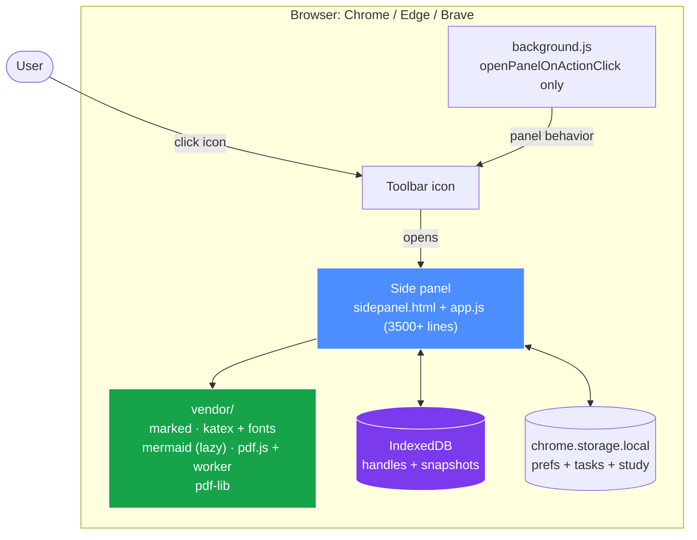

### Diagram 2 — Folder map

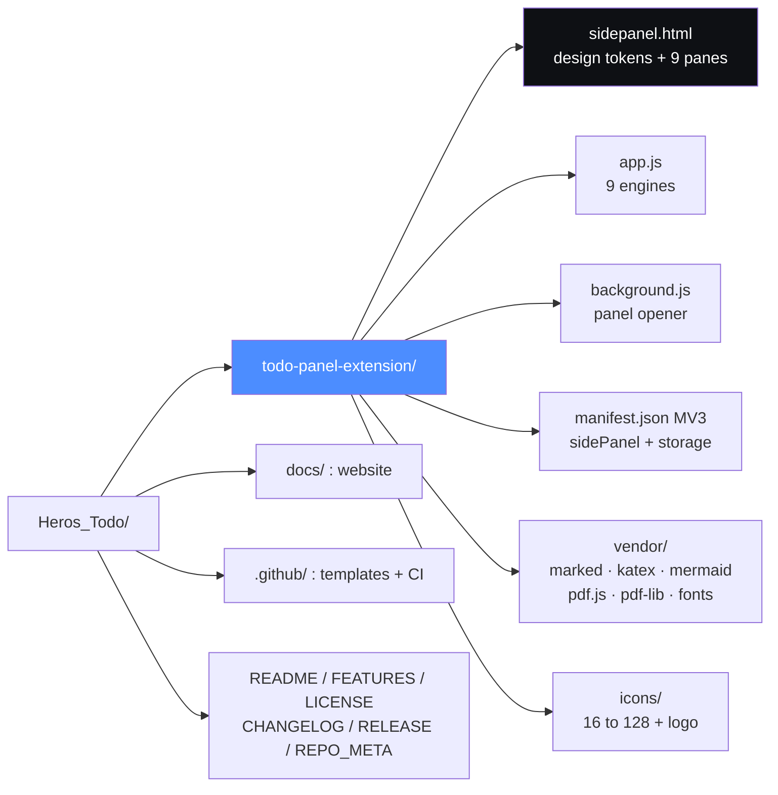

### Diagram 3 — Panel lifecycle (install to reading)

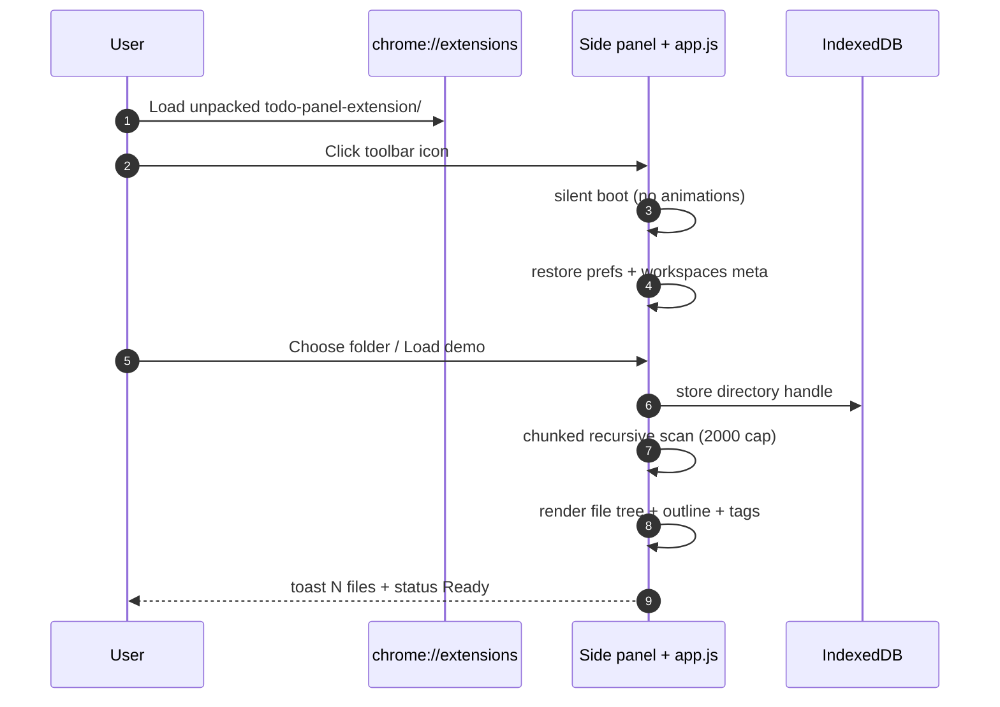

### Diagram 4 — Storage and privacy (nothing leaves the device)

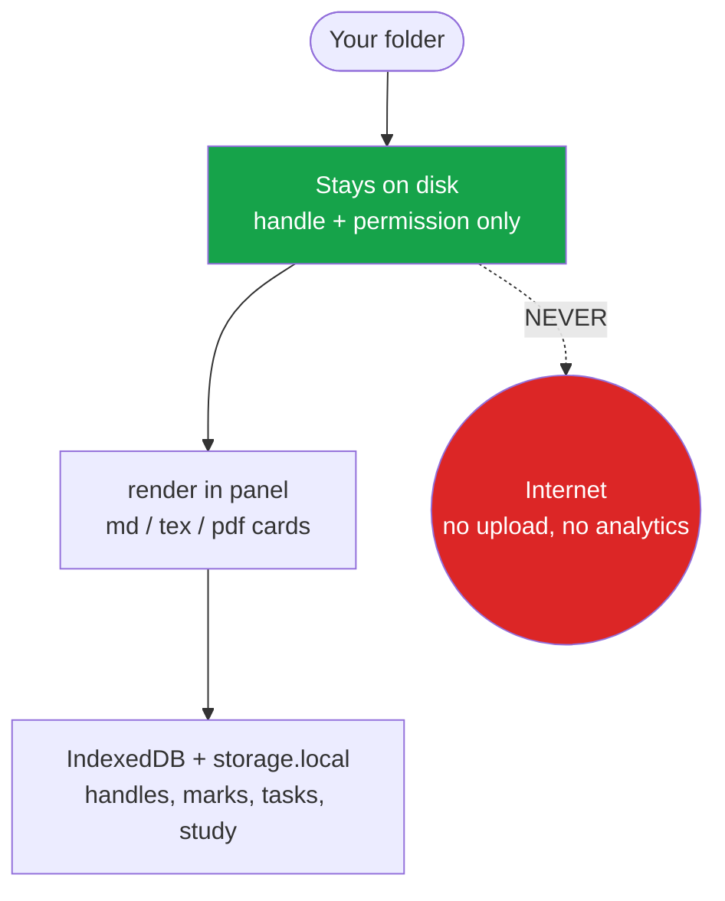

---

## Data Flow and Rendering Pipeline

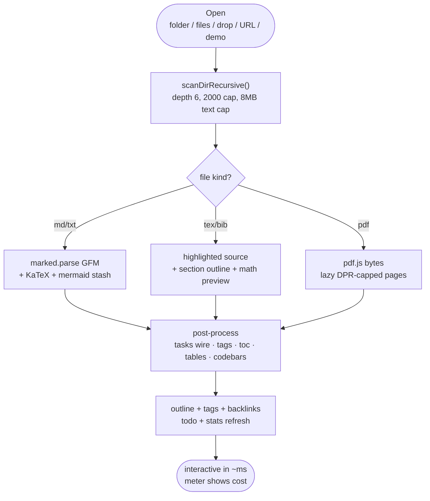

**Key engineering decisions (why it is fast):**

1. **Lazy everything** — PDF pages render on intersection (+700 px preload); Mermaid loads on idle; search indexes in chunks.
2. **Capped everything** — 2000 files, 800 search hits / 300 shown, 400 marks/file, 80 cards, 60 counters, 50 laps, 25 recents, 12 MB stored PDFs, 8 MB text reads.
3. **Debounced engine** — typing, filtering and scrolling never thrash the renderer.
4. **Fallback parser** — if a vendor ever fails, the built-in zero-dependency Markdown engine renders instead. The panel never goes blank.
5. **Silent boot** — boot class kills first-paint animations; persisted state restores instantly.
6. **Content-visibility** — off-screen PDF canvases skip paint.

---

## Markdown Engine

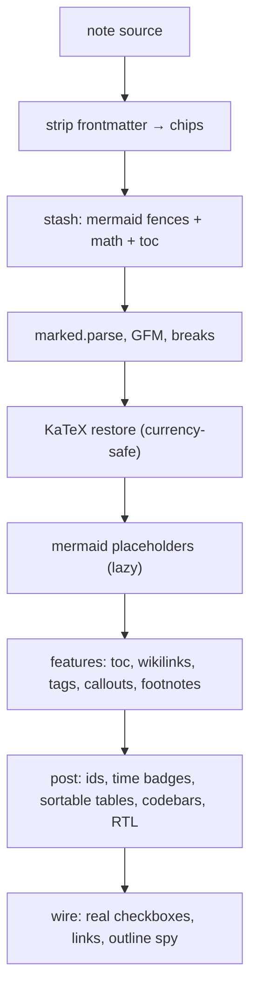

Rules that keep clicks exact: fenced code is stashed before parsing *and* before task extraction, so checkbox N always toggles task line N. Unclosed fences swallow the rest — in both engines identically.

## LaTeX Engine

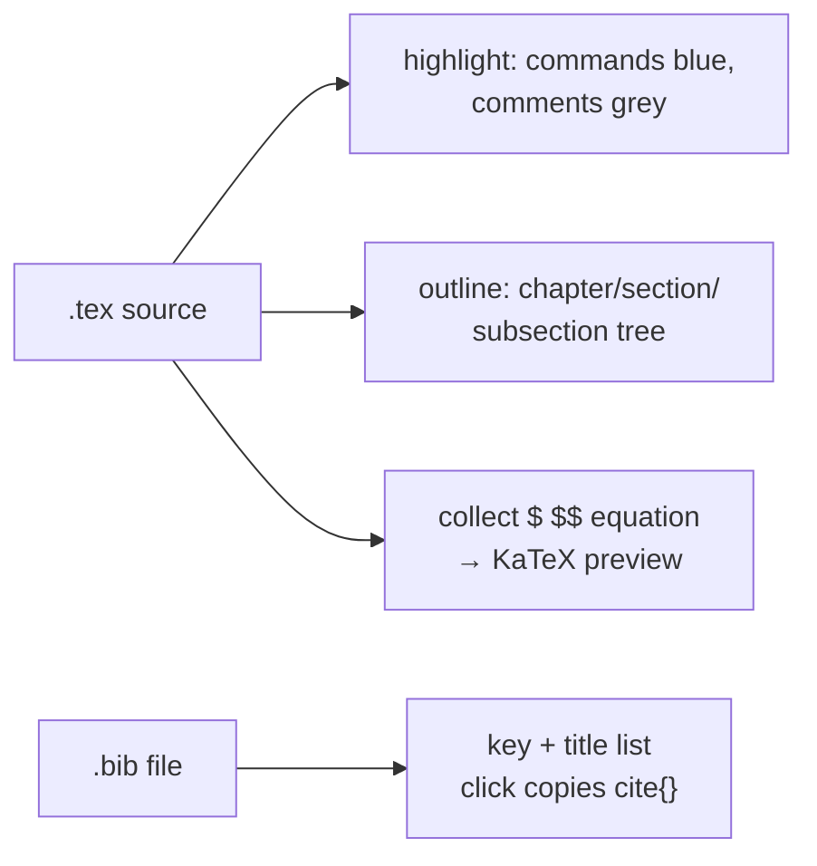

## PDF Engine in the Panel

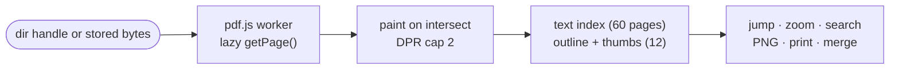

Folder workspaces stream PDFs straight from disk (unlimited size). Loose picked files over 12 MB are flagged with a one-tap remedy instead of failing silently.

## Workspaces and Files

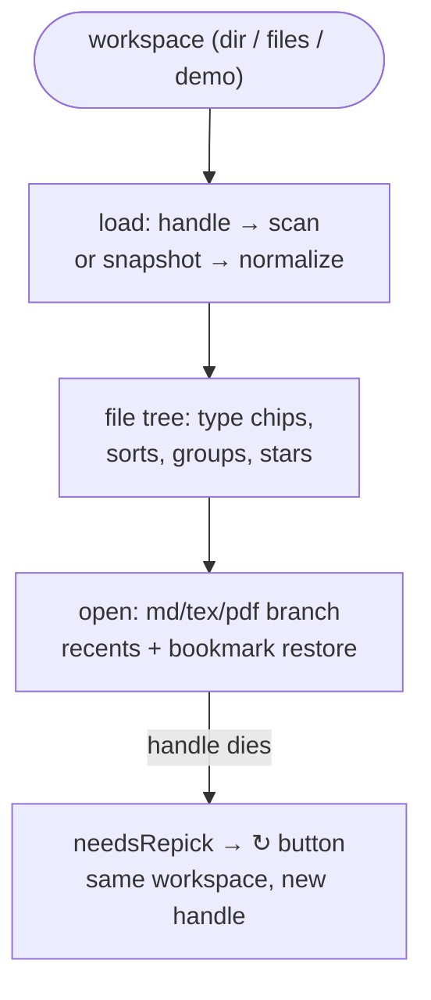

## Task Engine

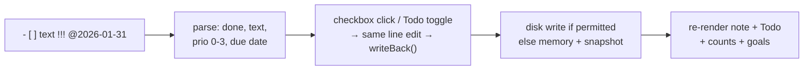

## Study System

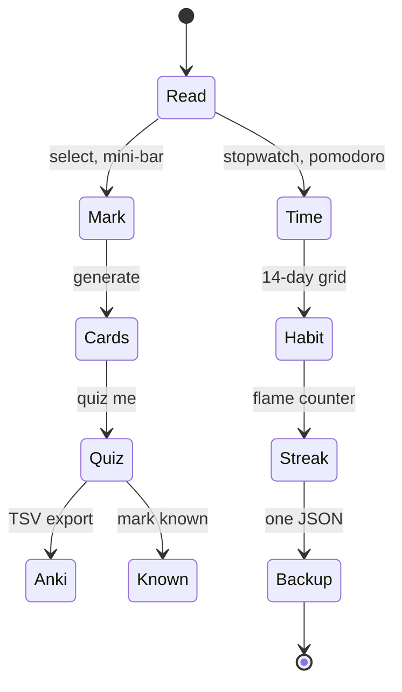

---

## Privacy and Security

- **2 permissions only:** `sidePanel` (show the panel), `storage` (prefs). No `<all_urls>`, no tabs, no scripting. See [`SECURITY.md`](./SECURITY.md).
- **Report privately:** Security Advisories on this repo — never a public issue.

| Asset | Where it lives | Who can see it |
|---|---|---|
| Your files | Your disk + in-memory render | Only you |
| Folder handles | IndexedDB, your profile only | Only you |
| Tasks, marks, cards, habits, notes | `chrome.storage.local`, your profile only | Only you |
| Prefs + theme | `chrome.storage.local` | Only you |
| Network | Only URLs you explicitly open | Nobody else |

### Security boundary diagram

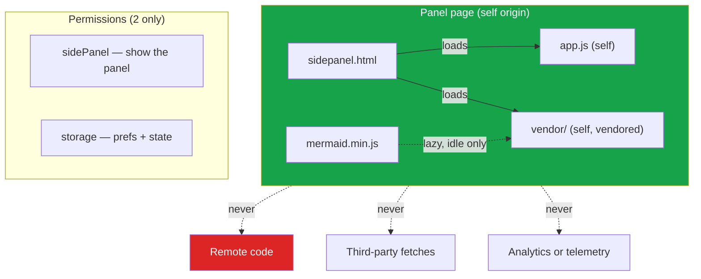

### Backup data flow

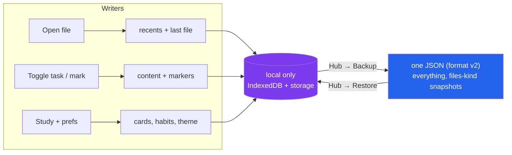

---

## Sequence Flows — End-to-End Journeys

### Flow 1 — Add a folder, click a real checkbox

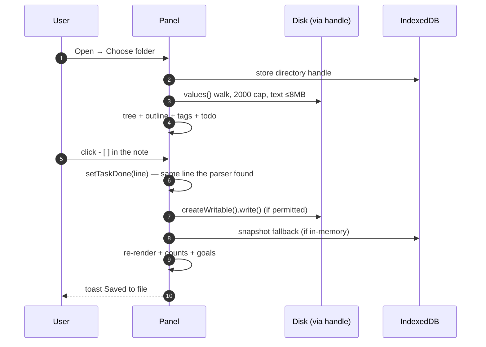

### Flow 2 — Stale handle recovery (the `[object DOMException]` killer)

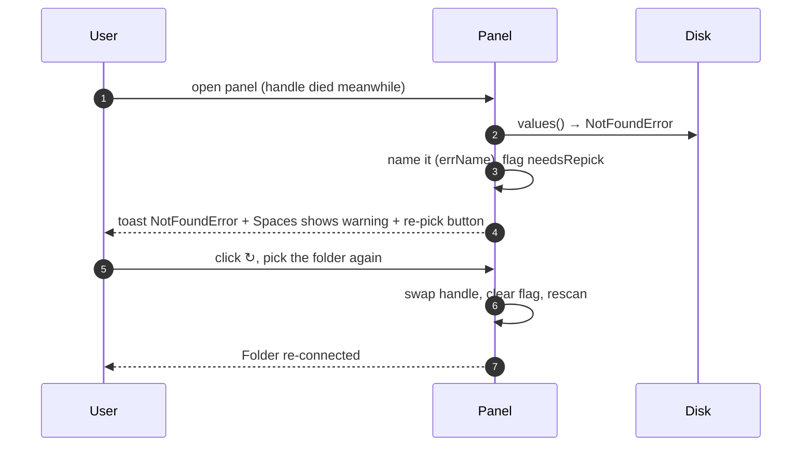

### Flow 3 — Quiz to Anki

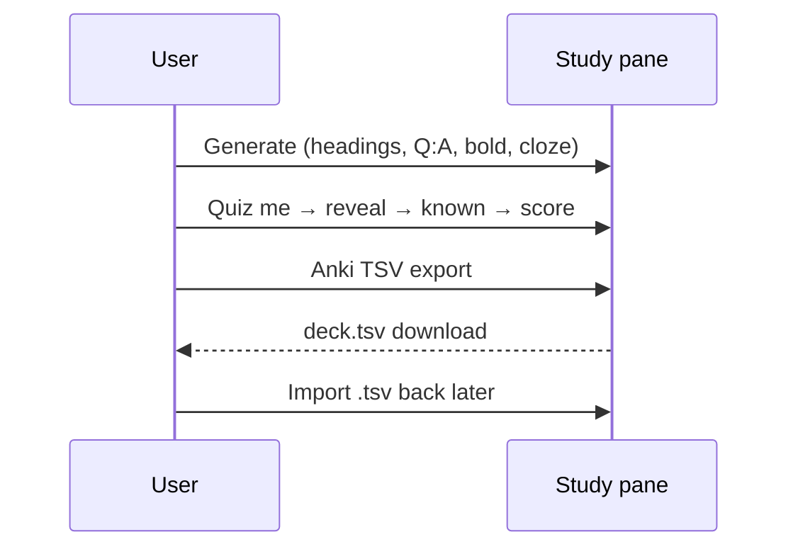

### Flow 4 — Backup and move machines

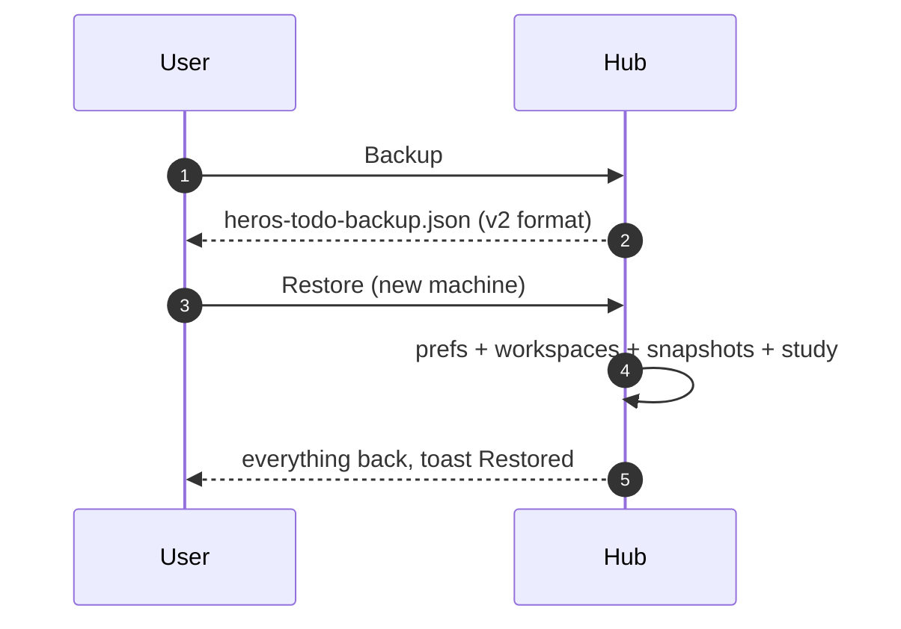

---

## Error Handling and Resilience

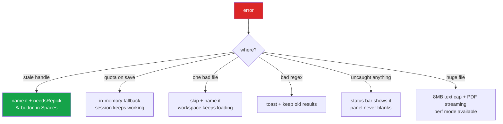

Guarantees: named errors (never `[object …]`), no dead buttons (every handler toasts on failure), no infinite retries, debounced idempotent saves, one skipped file never aborts a workspace, and uncaught rejections land in the status bar instead of a white panel.

---

## Accessibility

- Keyboard-operable end to end (20+ keys, `?` help, palette for everything).
- `:focus-visible` rings on every control; logical tab order.
- `prefers-reduced-motion` collapses animation to near-zero.
- Screen-reader labels on icon-only buttons (`aria-label`, `title`).
- Contrast tokens tuned per theme; page content untouched for fidelity.
- Touch: 32 px+ targets, momentum scrolling, drawer sidebar.

---

## Installation — 30 Seconds

Works in any Chromium browser. The extensions-page URL differs per browser; the steps do not.

```bash
# 1. Get the code
git clone https://github.com/Ahmedbakr78/Heros_Todo.git
cd Heros_Todo

# 2. Open YOUR browser's extensions page (table below)
# 3. Enable Developer mode
# 4. Load unpacked → select:
#    Heros_Todo/todo-panel-extension/
# 5. Pin Heros Todo to the toolbar. Done — click it, the panel opens.
```

| Browser | Type in the address bar | Notes |
|---|---|---|
| Google Chrome | `chrome://extensions` | Developer mode top-right |
| Microsoft Edge | `edge://extensions` | Same flow |
| Brave | `brave://extensions` | Same flow |
| Opera | `opera://extensions` | Same flow |
| Arc / Vivaldi | `arc://extensions` / `vivaldi://extensions` | Same flow |

### Install flow

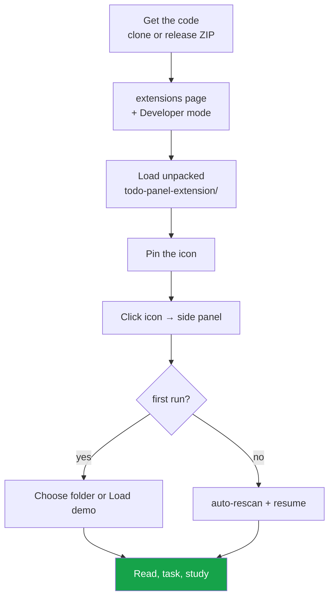

### After install — 3 checks

1. Click the icon → panel opens (if a tab opened instead, you loaded the wrong folder).
2. Hub profile line reads `v2.1.0` (proves the new code is running — always press **Reload ↻** on the extension card after updating files).
3. Open `Ctrl+K` → 40+ commands; open demo → math renders, diagram renders, `- [ ]` clicks.

### Local files note

Picker, drag & drop and the demo need **no** extra permission. `file://` deep-links additionally want **Allow access to file URLs** on the extension Details page (a Chromium rule, not a bug).

---

## Usage Guide

| I want to… | How |
|---|---|
| Open my notes | Open → Choose folder, or drag & drop a folder onto the panel |
| See everything | Files tab: type chips, folder tree, 6 sorts, filter box |
| Jump sections | Outline tab (headings / TEX sections / PDF bookmarks + thumbs) |
| Toggle a task for real | Click the `- [ ]` box in the note, or Todo tab → check |
| Add a task | Todo input + Enter (appends to open file or `inbox.md`) |
| Due today | Todo → Today button, or due seg: Overdue / Today / Upcoming |
| Daily habit note | Todo → Daily (creates `YYYY-MM-DD.md`) |
| Surprise me | Todo → Shuffle (random note) |
| Search everything | `Ctrl+F`, regex `.*` mode, case + whole-word, TXT export |
| Find in this file | `Ctrl+Shift+F`, ↑ ↓ cycle with counts |
| Read to me | Speaker button (voice select, speed, chunk x/y, Stop) — works on notes, selections and PDFs |
| Flashcards | Study → Generate → Quiz me → Anki TSV |
| Time a session | Study → Stopwatch (laps) or Pomodoro (chime) |
| Track habits | Study → add habit → tap the 14-day grid |
| Edit | `E` → insert bar → `Ctrl+S` (drafts auto-save, dot shows dirt) |
| Toggle task in editor | `Ctrl+Enter` on its line |
| Insert table/TOC | Edit row buttons (rows×cols prompt, headings index) |
| Rename/copy/delete file | Files → Rename / Copy / Del (active file) |
| Star / pin | Star files, pin + color workspaces |
| Copy outline/stats/HTML | Hub → This note card |
| Lint / summary / diff | Hub → Builder & lab card |
| Back up everything | Hub → Backup (one JSON), Restore to rebuild |
| Every command | `Ctrl+K` palette (40+) |

---

## Keyboard Shortcuts

| Keys | Action | Keys | Action |
|---|---|---|---|
| Ctrl+K | Command palette (40+) | Esc | Close dialog |
| Ctrl+F | Workspace search | Ctrl+Shift+F | Find in file |
| Ctrl+B | Sidebar drawer | E / Ctrl+S | Edit / save |
| Ctrl+Enter (editor) | Toggle task line | O | Todo scope |
| D | Save position | S (reading) | Read aloud |
| T | Theme (dark·light·system) | N | Page mode |
| + / - | Font size | j / k / / | Vim scroll + search |
| Alt+1–6 (editor) | Templates | ? | Help |
| P / F11 | Present / fullscreen | - | - |

---

## Todo Handbook

Syntax per line: `- [ ] text !!! @YYYY-MM-DD` — priority (`!`/`!!`/`!!!`) and due date are optional and order-free.

| Input | Meaning |
|---|---|
| `- [ ] Buy milk` | Open task |
| `- [x] Done` | Completed (struck, counted in Done) |
| `!!!` / `!!` / `!` suffix | High / medium / low — badge + sort first |
| `@2026-01-31` anywhere | Due date — chip, bucket, overdue red |
| Scope seg | This file vs Everything |
| Filter segs | All / Active / Done × Anytime / Overdue / Today / Upcoming |

Sorting: open first, then priority, then due date. Counts feed the file rows, status bar, Hub stats and writing goals.

## Search Handbook

| Control | Effect |
|---|---|
| Query | 800-hit cap, 300 shown, 45+65 char snippets |
| `Aa` | Case sensitive |
| `Whole` | Whole-word (Unicode-aware) |
| `.*` | Raw regex (invalid patterns toast, results kept) |
| TXT | Download results |
| Find bar | In-file only, code/math excluded, ↑ ↓ + count |

## Builder Lab Handbook

| Tool | What it does locally |
|---|---|
| Lint | Long lines, empty links, heading jumps, broken `#anchors` |
| Summary | Top sentences by word frequency |
| Keywords / Frequency | Significant terms + counts + CSV |
| Readability | Flesch ease + grade level |
| Diff | Two-file LCS view + unified patch export |
| Links | Internal anchors + external list check |
| Spell | Built-in wordlist + persistent ignore list |
| Templates | Study, meeting, exam, journal, thesis, habit |
| Custom CSS | Live overrides, saved per device |
| Perf mode | Text first, math/diagrams on demand |

## Export Handbook

| Format | How | Notes |
|---|---|---|
| `.md` | Hub → .MD / Save | Source incl. edits |
| `.txt` | Hub → .TXT | Formatting stripped |
| `.html` | Hub → HTML | Styled standalone page |
| `.pdf` (print) | Hub → Print/PDF | Print stylesheet |
| `.json` | Hub → JSON | Headings, tasks, tags, marks |
| `.csv` | Hub → CSV freq | Spreadsheet word table |
| `.svg` | Diagram → SVG | Per-diagram vector |
| `.tsv` | Study → Anki TSV | Question TAB Answer |
| Study pack | Hub → Study pack | Outline + tasks + source |
| Backup `.json` | Hub → Backup | Full state, v2 format |

---

## Themes and Eye Comfort

| Mode | UI | Pages | When to use |
|---|---|---|---|
| Dark (default) | Dark surfaces, bright accent | Normal | Night work, OLED |
| Light | White surfaces, blue accent | Normal | Daytime |
| System | Follows the OS live | Normal | Mixed environments |
| Night-pages | Either UI | Inverted canvas | Pure-night reading |
| Sepia | Either UI | Sepia filter | Long book sessions |
| Dim | Either UI | Dimmed brightness | Low light |

Plus: 6 accents + picker, 4 reading widths, 3 fonts, line-height slider, justify, sentence focus, focus mode, fullscreen + present. All persist instantly.

---

## Responsive and Panel-First

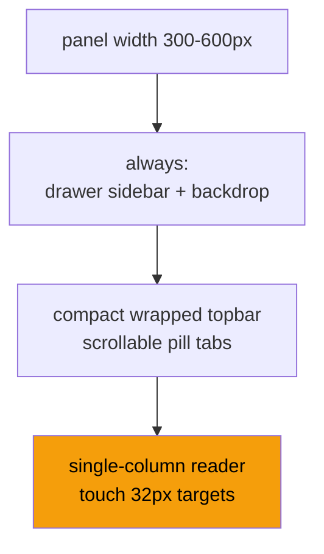

The sidebar is *always* a drawer (panels are narrow by nature). Nothing is hidden at any width — controls compress, never disappear. Scrollbars stay hidden app-wide for the clean Heros feel.

---

## Performance Engineering

| Technique | Where | Effect |
|---|---|---|
| Lazy PDF + 700px preload | IntersectionObserver | 1000-page PDFs open instantly |
| DPR cap 2 | PDF + thumbs | Retina-crisp, bounded memory |
| Idle Mermaid | requestIdleCallback queue | Diagrams never block paint |
| Chunked scans | Folder walk | Exact tree, no jank |
| Capped search (800/300) | runSearch | No freeze on short queries |
| Debounced inputs | Filter, search, drafts | No render thrash |
| 8MB text / 12MB stored-PDF caps | Loaders | Memory-safe by construction |
| content-visibility | Canvases | Skipped off-screen paint |
| Silent boot | boot class | Instant first paint |
| Render meter | md-bar + Hub | Every render self-reports ms |

Budgets: panel opens instantly; 2000-file folders list in seconds; search for "e" stays responsive; one canvas per visible PDF page; zero network after install.

---

## Design System and Visual Language

Copied 1:1 from Heros PDF, then extended for notes. Every surface follows the same contract in every theme.

### Shell anatomy

```mermaid
flowchart TB
    subgraph SHELL["Panel shell (sidepanel.html)"]
        direction TB
        TBAR["Topbar — floating card<br/>brand + open + workspace + actions"]
        MAIN["Main — drawer sidebar + reader"]
        SB["Statusbar — rounded top<br/>status + counts + quick actions"]
        TBAR --> MAIN
        MAIN --> SB
        MAIN --> SIDEBAR["Sidebar card — pill tab bar<br/>9 panes"]
        MAIN --> READER["Reader — md / tex / pdf cards<br/>+ find + read + progress bars"]
    end
    subgraph OVERLAYS["Floating layers"]
        direction TB
        SEL["Selection mini-bar"]
        PAL["Palette + features modals"]
        TST["Toasts (bottom, stretched)"]
        MENU["Dropdown menu + modal"]
        PRG["Top progress bar"]
    end
    SHELL --> OVERLAYS

    style TBAR fill:#4c8dff,color:#fff
    style SIDEBAR fill:#7c3aed,color:#fff
```

### Design tokens

| Token family | Light | Dark | Notes |
|---|---|---|---|
| Surfaces | `#ffffff`, `#f3f5f8`, `#e8ebf0` | `#191d24`, `#21262e`, `#2a3038` | Card, control, raised |
| Text | `#14181f`, `#4a5568`, `#7b8697` | `#e7eaf0`, `#b0b9c6`, `#79839a` | Primary, secondary, muted |
| Accent | `#2563eb` | `#4c8dff` | 6 presets + custom + per-workspace color |
| Radii | 20 / 14 / 11 / 7 px + 999px pill | same | Cards, buttons, controls, pills |
| Elevation | 3 shadow levels | same | Plus dedicated page shadow |

### Roundness contract

| Component | Radius | Component | Radius |
|---|---|---|---|
| Topbar / sidebar / statusbar | 18–26 px | Toasts | 14 px |
| Side tab bar / pagebox / chips | pill (999px) | Modals | 22 px |
| File rows / results / todo rows | 12–16 px | Stat / tool / flash cards | 18–20 px |
| Group boxes / code / tables | 12–14 px | Empty card | 26 px |

---

## Internals — Inside app.js

One dependency-free script (~3500 lines) organized in engines, so contributors navigate by engine name.

```mermaid
flowchart TB
    subgraph APP["app.js — engine map"]
        direction TB
        CORE["core: helpers, IDB, storage<br/>theme, sidebar, toasts"]
        WS["workspaces + files<br/>scan, tree, sort, ops, recents"]
        RENDER["render: marked + fallback<br/>tex, pdf.js, outline, tags"]
        STUDY["study: marks, cards, quiz<br/>timers, habits, goals"]
        LAB["lab: lint, stats, diff<br/>exports, palette, features"]
        CORE --> WS --> RENDER --> STUDY --> LAB
    end
    subgraph STATE["State object S"]
        ST1["workspaces, files, activePath"]
        ST2["prefs: theme, accent, fonts"]
        ST3["study: marks, cards, habits"]
    end
    APP --- STATE

    style WS fill:#16a34a,color:#fff
    style RENDER fill:#4c8dff,color:#fff
```

Key invariants (enforced by review):

1. Every render path is guarded — one bad file shows a named error card, never a blank panel.
2. Click-mapping is exact — parser and renderer agree on fences, so checkbox N toggles task line N.
3. Nothing leaves the device — the only `fetch` is a URL the user typed.
4. Every add is capped or idle-scheduled — see the performance table.
5. Panel-only forever — no tabs, no navigation interception, no new permissions without an issue.

---

## Release and Publishing Pipeline

```mermaid
flowchart LR
    DEV["branch feat/..."] --> PR["Pull Request"]
    PR --> CI["ci.yml:<br/>files exist, manifest valid<br/>panel-only, versions agree<br/>JS syntax, docs clean"]
    CI --> REVIEW["review + smoke test<br/>(folder, PDF, math, backup)"]
    REVIEW --> MERGE["merge to main"]
    MERGE --> PAGES["GitHub Pages<br/>auto-deploys docs/"]
    MERGE --> TAG["tag vX.Y.Z"]
    TAG --> REL["gh release create<br/>ZIP + RELEASE notes"]
    REL --> LATEST["mark Latest"]

    style CI fill:#16a34a,color:#fff
    style REL fill:#4c8dff,color:#fff
```

Versioning: SemVer. Manifest version, CHANGELOG top entry, RELEASE file and git tag must always agree — CI fails otherwise.

---

## Contribution Workflow

```mermaid
sequenceDiagram
    autonumber
    participant C as Contributor
    participant F as Fork
    participant CI as CI
    participant M as Maintainer

    C->>F: fork + branch feat/my-thing
    C->>F: edit (vanilla only, capped, panel-tested)
    C->>C: node --check + 360px dark/light test
    C->>M: open PR with template
    CI->>M: files, manifest, versions, syntax
    M->>M: review + smoke test
    alt needs work
        M->>C: requested changes
        C->>F: push fixes
    else approved
        M->>M: merge → tag → release
    end
```

Rules: one logical change per PR, vanilla only, capped work, panel parity at 360 px, never commit backups or private notes (already in `.gitignore`).

---

## Compatibility Matrix

| Platform | Status | Notes |
|---|---|---|
| Chrome (MV3 sidePanel) | Supported | Reference target |
| Microsoft Edge (MV3) | Supported | `edge://extensions` |
| Brave | Supported | Shields don't affect local panel |
| Opera / Arc / Vivaldi | Supported | Any current Chromium |
| Speech (read aloud) | Varies | Needs an OS/browser voice |
| File System Access | Chromium only | Elsewhere: pick-files fallback |
| Firefox / Safari | Roadmap | Needs ports (see below) |
| Offline | Full | All engines vendored after install |

---

## Project Stats

| Metric | Value |
|---|---|
| App code | ~3,500 lines JS + ~1,500 lines HTML/CSS, zero frameworks |
| Vendored engines | marked, KaTeX + fonts, Mermaid (lazy), pdf.js + worker, pdf-lib |
| Documented features | 236 rows in FEATURES.md |
| Documented rows | 220 in `FEATURES.md` |
| Diagrams in README | 16 (all render on GitHub) |
| Permissions | 2 (`sidePanel`, `storage`) |
| Runtime deps | None — no build step, no tracking |
| Price | Free forever, MIT |

---

## Glossary

| Term | Meaning |
|---|---|
| Workspace | One folder (dir), picked files, or the demo — with its own files + last note |
| Handle | A `FileSystemDirectoryHandle` — the browser's permission-carrying folder link |
| needsRepick | Flag set when a handle dies; the ↻ button swaps a fresh one in |
| Snapshot | Files-kind workspace bytes stored in IndexedDB (12 MB PDF cap) |
| docId-ish key | `workspaceId + path` — identity for stars, notes, marks, bookmarks |
| Task line | A `- [ ]`/`- [x]` line with optional `!!!` priority and `@YYYY-MM-DD` due |
| Bucket | Overdue / Today / Upcoming classification of a due date |
| Deck | Flashcards generated from headings, Q:/A:, bold terms, cloze blanks |
| Study pack | One exported file: outline + tasks + source |
| Backup v2 | Full-state JSON: prefs, workspaces, snapshots, study, notes |
| Render meter | The ms readout proving each render's cost |
| Silent boot | No startup animations — first paint is instant |

---

## Repository Structure

```text
Heros_Todo/
├── README.md                        ← you are here (the big one)
├── FEATURES.md                      ← 220 grouped rows
├── LICENSE                          ← MIT
├── CHANGELOG.md                     ← every version, newest first
├── RELEASE_v2.1.0.md                ← current release notes
├── REPO_META.md                     ← About, topics, website, release setup
├── CONTRIBUTING.md                  ← how to help
├── CODE_OF_CONDUCT.md               ← be kind
├── SECURITY.md                      ← report privately
├── SUPPORT.md                       ← fixes for common issues
├── _config.yml                      ← GitHub Pages settings (docs/ site)
├── .gitignore                       ← backups and private notes never commit
│
├── todo-panel-extension/            ← THE EXTENSION (load this folder unpacked)
│   ├── manifest.json                ← MV3 v2.1.0, sidePanel + storage only
│   ├── sidepanel.html               ← design tokens + 9 panes + reader
│   ├── app.js                       ← 9 engines, zero dependencies
│   ├── background.js                ← openPanelOnActionClick only
│   ├── icons/                       ← 16 → 128 + logo
│   └── vendor/                      ← marked, katex(+css+fonts), mermaid,
│                                      pdf.js(+worker), pdf-lib — all offline
├── docs/
│   └── index.html                   ← public website (GitHub Pages)
└── .github/
    ├── ISSUE_TEMPLATE/              ← bug report + feature request
    ├── PULL_REQUEST_TEMPLATE.md
    └── workflows/ci.yml             ← files, manifest, versions, syntax
```

---

## Tech Stack

| Layer | Choice | Why |
|---|---|---|
| Markdown | marked 12 (vendored) + built-in fallback | GFM correctness, offline, never-blank |
| Math | KaTeX 0.16 + bundled fonts | Fast, offline, currency-safe |
| Diagrams | Mermaid 11, lazy idle load | 9 types, themed, no boot cost |
| PDF view | pdf.js + worker (vendored) | Lazy pages, text index, outline |
| PDF edit | pdf-lib (vendored) | Merge without servers |
| Speech | SpeechSynthesis (built-in) | Zero deps, local voices |
| Storage | IndexedDB + chrome.storage.local | Handles + state, capped |
| UI | Vanilla JS, no framework, no build | Silent boot, tiny review surface |
| Docs site | Static HTML + Jekyll minima | Free Pages hosting |

---

## Roadmap

```mermaid
gantt
    title Heros Todo roadmap
    dateFormat YYYY-MM-DD
    axisFormat %Y
    section Shipped
    Panel todo + workspaces (1.0)      :done, a, 2026-10-01, 2026-10-13
    Power md/pdf/tex + study (2.0)     :done, b, 2026-10-13, 2026-10-13
    Wave 3 max-out + hardening (2.1)   :done, c, 2026-10-13, 2026-10-14
    section Next
    Plugin templates API               :active, d, 2026-11-01, 2027-01-01
    Optional local sync                :e, 2027-01-01, 2027-04-01
    section Platforms
    Firefox port                       :crit, f, 2027-02-01, 2027-06-01
    Store listings                     :g, 2027-04-01, 2027-07-01
```

```mermaid
pie title Heros Todo capabilities by area
    "Read" : 65
    "App + comfort" : 45
    "Write + builder" : 39
    "Files + workspaces" : 25
    "Time + tasks" : 24
    "Exports" : 23
    "Study" : 16
    "PDF" : 8
```

---

## FAQ — 20 Questions

**The panel shows an old version.** Press Reload (↻) on the extension card in `chrome://extensions`. Hub must read the new version.

**`Could not read folder: NotFoundError…`** The saved folder link died. Spaces → ↻ on that workspace, pick the folder again. Nothing is lost.

**`…NotAllowedError…`** Click Allow on the permission prompt, then re-pick via ↻.

**A PDF says "too large".** Loose picked files over 12 MB can't be stored — add their folder as a workspace; PDFs then stream from disk with no size cap.

**`- [ ]` won't click.** You run a pre-2.1 copy — Reload the extension. Since 2.1 every rendered checkbox toggles the real file line.

**A very large note feels slow.** Enable perf mode (Hub → Speed & CSS): text paints instantly, math/diagrams render on demand. The meter shows each render's ms.

**Marks/tasks disappeared.** They live per file key (`workspace + path`). Renaming a file orphans its marks — rename inside the app (Files → Rename) to keep them.

**Does read-aloud need internet?** No — it uses built-in local voices. If your browser has none, everything else still works.

**Can I use it on the phone?** Any Chromium Android browser with extension side panels; otherwise export study packs and read them anywhere.

**Can I move machines?** Hub → Backup → copy the JSON → Restore. Folder workspaces need one re-pick on the new machine (browser security).

**Is there sync?** No cloud sync by design. Optional local sync is on the roadmap.

**Why only 2 permissions?** The panel needs nothing else. New permissions require an issue first — that's policy.

**Can I style it myself?** Hub → Custom CSS, live-applied and saved per device.

**How do I print?** Hub → Print/PDF, or `Ctrl+P` (print stylesheet included).

**How do I present?** Topbar More menu → presentation mode (black slide view).

**Vim keys?** `j`/`k` scroll, `/` searches, `gg`-style jumps via outline, `Alt+1–6` templates in the editor.

**Is it really free?** Yes — MIT, unlimited files/tasks/merges/diagrams, no accounts.

**Where do I ask for more?** Feature-request issue (one idea each) — see [REPO_META](./REPO_META.md) and [CONTRIBUTING](./CONTRIBUTING.md).

**How is this related to Heros PDF / Heros Markdown?** Same design system and study ideas, rebuilt as a panel studio. Those repos were never modified — vendors were copied read-only.

---

## Changelog and Releases

- Every version: [`CHANGELOG.md`](./CHANGELOG.md), newest first.
- Current notes + ZIP: [`RELEASE_v2.1.0.md`](./RELEASE_v2.1.0.md) and the [releases page](https://github.com/Ahmedbakr78/Heros_Todo/releases/latest).
- Version trio must agree (manifest ↔ CHANGELOG ↔ tag) — CI enforces it.

---

## GitHub Topics, About and Website Setup

Everything copy-paste ready in [`REPO_META.md`](./REPO_META.md): About description, 20 topics + `gh` command, Pages setup (`main` → `/docs`), social preview, release commands, and the first-day checklist.

Website source: [`docs/index.html`](./docs/index.html) — zero dependencies, same rounded design language, install + features + FAQ.

---

## License and Credits

MIT — see [LICENSE](./LICENSE). Free and unlimited forever.

## Author

**Ahmed ABOBAKR**

| | |
|---|---|
| GitHub | [github.com/Ahmedbakr78](https://github.com/Ahmedbakr78) |
| LinkedIn | [Ahmed Abo Bakr](https://www.linkedin.com/in/ahmed-abo-bakr-1b2466288/?isSelfProfile=true) |

Built and maintained as a free tool for students, developers and researchers who want a private, offline notes studio in the browser side panel. Feedback, issues and pull requests are welcome on the repository.

Engines that make it possible (all vendored, all offline): [marked](https://github.com/markedjs/marked) (GFM), [KaTeX](https://katex.org/) (math), [Mermaid](https://mermaid.js.org/) (diagrams), [PDF.js](https://mozilla.github.io/pdf.js/) (viewing), [pdf-lib](https://pdf-lib.js.org/) (merging). Design system-forged alongside Heros PDF and Heros Markdown — as read-only references, never modified.

Feedback, issues and PRs are welcome — see [CONTRIBUTING](./CONTRIBUTING.md) and [SUPPORT](./SUPPORT.md).
